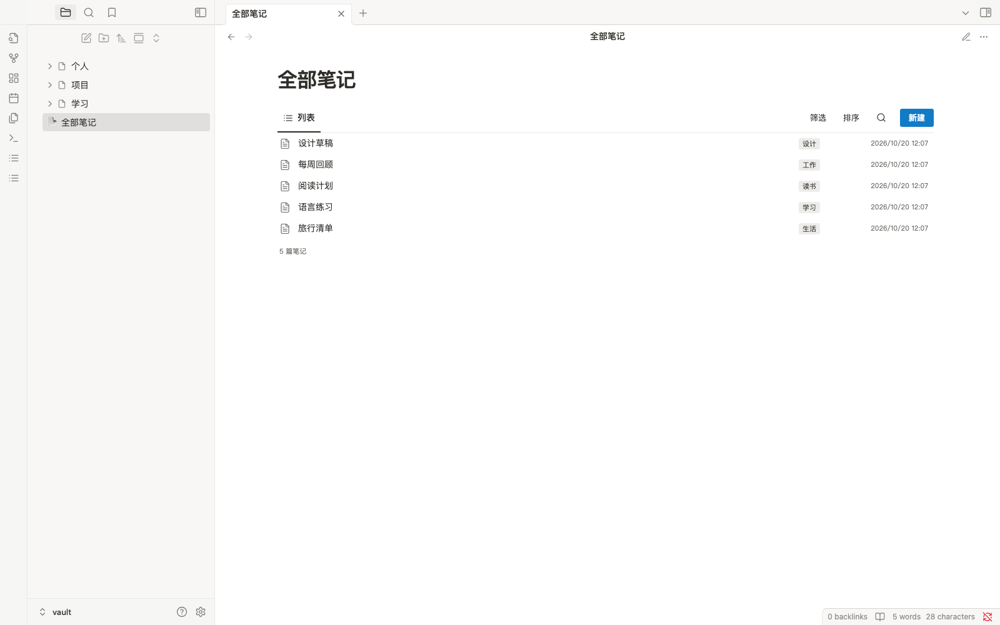

# Shadcn Workspace

由 **Clark Lei** 维护的 Obsidian 插件：一次安装，同时获得 Shadcn 风格外观和本地笔记列表，无需另装主题或 CSS 片段。

This Obsidian plugin combines a Shadcn-inspired appearance with a live local note list. Install one plugin, with no separate theme download.



## 功能

- 浅色与深色配色、简洁侧栏、紧凑笔记行、标签和最近修改日期。
- 搜索标题、目录和标签；按顶层目录筛选；默认顺序、名称和最近修改排序。
- 点击打开笔记；Command / Control 点击打开新标签页。
- 新建真实 Markdown 文件，拒绝覆盖同名文件。
- 笔记创建、修改、删除和重命名后自动刷新。
- 外观开关关闭后恢复当前主题，列表继续工作；停用插件会移除外观样式。
- 不发送网络请求，不包含遥测，不自动下载其他插件。

## 安装

目前尚未提交 Obsidian 社区目录审核，请手动安装：

1. [下载安装包](https://github.com/leoskey/obsidian-shadcn/raw/refs/heads/main/downloads/shadcn-workspace-1.0.0.zip)，解压出 `shadcn-workspace` 文件夹。
2. 将文件夹放入目标仓库的 `.obsidian/plugins/` 中。确认 `main.js`、`manifest.json`、`styles.css` 直接位于 `.obsidian/plugins/shadcn-workspace/`，避免多套一层目录。
3. 保存编辑内容，完全退出并重新打开 Obsidian。
4. 在「设置 → 第三方插件」按 Obsidian 提示允许社区插件，并启用 **Shadcn Workspace**。
5. 按 Command / Control P，运行 **Shadcn Workspace: 打开全部笔记**，或点击左侧工具栏的列表图标。

插件首次运行该命令时会创建 `全部笔记.md`。已存在的同名文件不会被覆盖；若文件里没有列表代码块，插件会提示手动添加。

如果只有仓库源码，可运行 `python3 scripts/build.py` 生成 ZIP，也可以直接复制根目录的 `main.js`、`manifest.json`、`styles.css` 和许可证文件。

建议使用 Obsidian 默认主题，外观选择「浅色」以接近参考图。其他主题的强制样式可能影响结果。设置中的 **启用 Shadcn 风格外观** 可单独关闭，插件不会改写外观配置或切换主题。

## 在自己的页面中插入列表

添加以下代码块，在阅读视图中查看：

````markdown
```shadcn-list
```
````

若需要宽版列表布局，在页面属性中添加 `cssclasses: [shadcn-list-page]`，可参考 `examples/全部笔记.md`。

列表排除当前列表页面、根目录的 `首页.md`，以及 `导航/` 和 `模板/` 下的笔记。目录筛选显示顶层目录；默认顺序沿用 Obsidian 返回顺序，不重新排序。无标签的笔记显示所属顶层目录，根目录笔记显示「笔记」。新建对话框默认提供「收件箱」目录，不存在时会在创建笔记时建立该目录。

日期使用设备的本地时区，表示文件最近修改时间。首次安装不会改动已有笔记内容或目录顺序。

## 开发与验证

无 npm 运行依赖或构建依赖；`main.js` 即插件源码。

```sh
node --check main.js
node tests/plugin.test.cjs
python3 scripts/build.py
```

最低支持版本为 Obsidian 1.8.7。桌面原生测试结果见 `TESTING.md`。移动端尚未实机验证。

## 许可与署名

本项目采用 MIT 许可证。上游版权声明与许可证保留在 `vendor/LICENSE`，来源和修改说明见 `THIRD_PARTY_NOTICES.md`。

本项目是独立社区插件，所有笔记保存在本地仓库。
